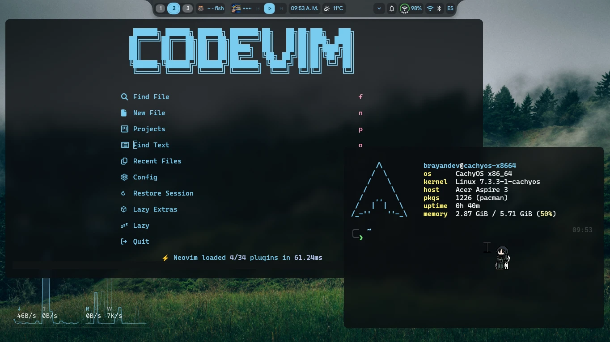
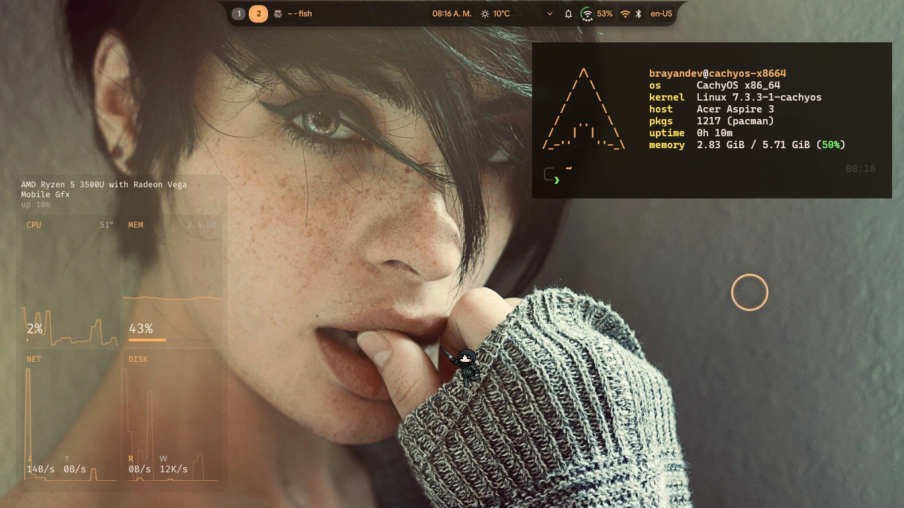
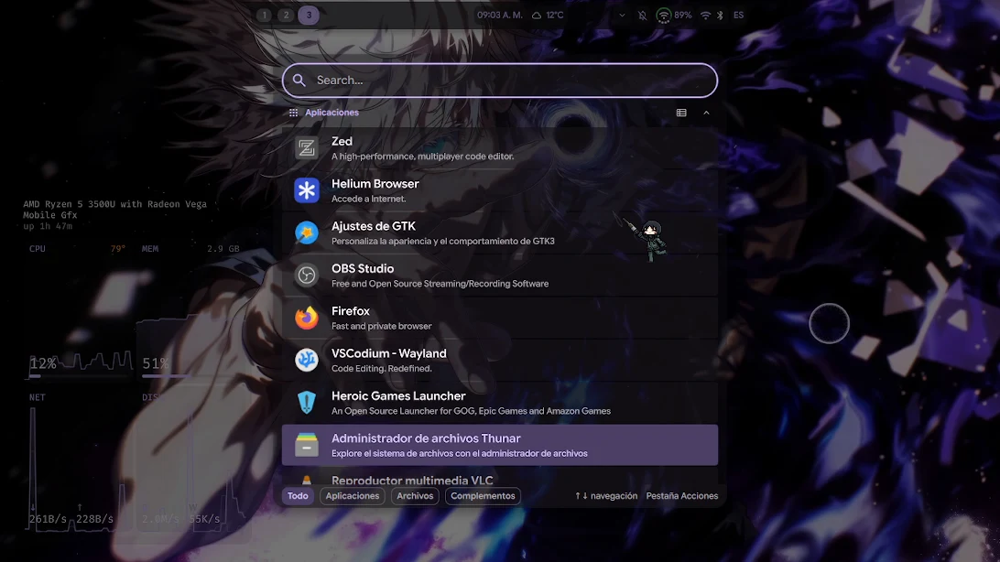

# SwayFX + DMS · Dotfiles de Brayan

Configuración modular de **SwayFX** con **DMS (Dux Modular Shell)** para
CachyOS/Arch, con un instalador que detecta tu sistema, instala dependencias,
adapta la configuración y **guarda un respaldo antes de tocar nada**.


[](https://github.com/BrayanDeLaOssa/Sway-fx-backup-dotsfiles/actions/workflows/ci.yml)

---

## Vista previa

<p align="center">
  
  
</p>

<p align="center">
  <em>Barra superior de DMS, efectos de SwayFX, kitty, Codevim, btop y wallpaper animado.</em>
</p>

<p align="center">
  <a href="assets/video/Demo.mp4">
    
  </a>
</p>

<p align="center">
  <strong><a href="assets/video/Demo.mp4">▶ Ver video completo (1:38)</a></strong>
</p>

> **Sobre el video:** GitHub no reproduce video incrustado desde un archivo del
> repositorio, así que la portada y el enlace abren el **video completo (1:38, ~7 MB)**.
> Si quieres que se reproduzca dentro del README, se puede subir como adjunto
> con el editor web de GitHub (límite de 10 MB en el plan gratuito).

> **Nota:** las capturas muestran extras personales como **fish**, **Codevim/Neovim**,
> **btop** y un wallpaper de **Wallpaper Engine**. Ese contenido no forma parte del
> repo; el instalador prepara la base de SwayFX + DMS y usa alternativas si no
> tienes esos programas.

---

## ¿Qué incluye?

- **SwayFX** con blur, esquinas redondeadas, sombras y animaciones.
- **DMS (Dux Modular Shell)**: barra, lanzador, OSD, notificaciones, portapapeles,
  bloqueo, capturas, panel de energía y selector de wallpapers.
- **Configuración modular** en `config.d/`, fácil de leer y editar:
  entorno, entrada, monitores, apariencia, efectos, reglas de ventana, atajos,
  workspaces, multimedia y wallpaper engine.
- **Kitty** con tema y pestañas integradas con DMS/matugen.
- **Wallpaper Engine animado** mediante `linux-wallpaperengine` y el plugin de DMS.
- **Instalador dinámico** con detección de distro, dependencias, respaldos,
  validación previa y desinstalación.
- **Modo portable** para Debian/Fedora o para quien no quiera DMS/SwayFX.
- **Cheatsheet de atajos** generado automáticamente dentro de la sesión.

---

## Compatibilidad

| Sistema | Soporte | Qué obtienes |
|---|---|---|
| **CachyOS / Arch / EndeavourOS / Manjaro** | ✅ Completo | SwayFX + DMS + AUR + extras |
| Debian / Ubuntu / Mint / Pop!_OS | ⚠️ Parcial | `sway` normal + modo portable sin DMS |
| Fedora / Nobara | ⚠️ Parcial | `sway` normal + modo portable sin DMS |
| Otras distros | 🧩 Solo archivos | Copia la config con `--no-deps` y adapta a mano |

> La experiencia de las capturas (blur, sombras, barra DMS, wallpaper engine)
> requiere **Arch/CachyOS con SwayFX y DMS**. En Debian/Fedora el instalador
> desactiva los efectos automáticamente para que la sesión no falle.

### Requisitos

- Linux **x86_64** con Wayland y drivers gráficos funcionando.
- `git`, `sudo` y conexión a internet.
- ~2 GB libres (más si instalas navegador y Wallpaper Engine).
- **No ejecutes el instalador con `sudo`.** Pedirá permisos solo para paquetes.

---

## Antes de instalar (checklist rápido)

1. **Guarda tu configuración actual** (el instalador también lo hace, pero mejor
   tener una copia propia):
   ```bash
   cp -a ~/.config/sway ~/.config/sway.bak.$(date +%Y%m%d) 2>/dev/null || true
   ```
2. Cierra otros instaladores de paquetes (`pacman`, `yay`, `apt`, `dnf`).
3. Conecta el cargador si estás en laptop.
4. Ten a mano tu contraseña de `sudo`.
5. Si vienes de otra sesión gráfica, guarda tu trabajo: cerrarás sesión al final.

---

## Instalación paso a paso (recomendada)

### 1. Clona el repositorio

```bash
git clone https://github.com/BrayanDeLaOssa/Sway-fx-backup-dotsfiles.git
cd Sway-fx-backup-dotsfiles
```

### 2. Ejecuta el instalador

```bash
./install.sh
```

Verás primero un resumen del entorno detectado:

```text
== Entorno detectado ==
  Distribución:         CachyOS Linux
  Gestor de paquetes:   pacman
  Helper AUR:           yay
  Sesión:               wayland (sway)
  Compositor:           swayfx version 0.6 ...
  DMS (dux-shell):      instalado (2.1.2-1.1)
  Usuario / HOME:       brayandev / /home/brayandev
```

Después te hará **como máximo estas preguntas**:

| Pregunta | Respuesta recomendada |
|---|---|
| `Se instalarán dependencias con pacman. ¿Continuar? [S/n]` | `Enter` o `s` |
| `Hay paquetes que solo están en AUR. ¿Instalar yay-bin automáticamente? [s/N]` | `s` si no tienes `yay`/`paru` |
| `¿Copiar también la configuración visual de DMS? [s/N]` | `s` para que se vea como en las capturas |

> Si no tienes helper AUR, el instalador puede compilar `yay-bin` por ti.
> Si rechazas, instalará `sway` normal y desactivará los efectos de SwayFX.

### 3. Espera la validación

Antes de copiar nada a tu `~/.config`, el instalador:

1. Copia los dotfiles a una carpeta temporal.
2. Los adapta a tu distro, terminal, navegador, fuente y cursor.
3. Comprueba la sintaxis de todos los scripts.
4. Valida la config con Sway en modo headless (`sway -C`).
5. **Solo si todo pasa**, respalda e instala.

Si la validación falla, **no se toca tu configuración** y te muestra el error exacto.

### 4. Cierra sesión y entra en `swayfx`

En la pantalla de login elige la sesión **`swayfx`** (en Debian/Fedora elige
**`sway`**). Si ya estabas dentro de Sway:

```bash
swaymsg reload
```

### 5. Comprueba que todo está bien

```bash
./install.sh doctor
```

Y dentro de la sesión pulsa:

```text
Super + Shift + /
```

para abrir el cheatsheet de atajos.

---

## Instalación automática (sin preguntas)

```bash
# Lo más parecido al setup de las capturas:
# navegador + Wallpaper Engine + configuración visual de DMS
./install.sh --full -y
```

Opciones útiles:

```bash
./install.sh --minimal -y        # solo lo esencial
./install.sh --no-deps           # solo copiar archivos, sin instalar paquetes
./install.sh -n                  # simular y ver qué haría
./install.sh --term foot         # usar otra terminal
./install.sh --mod Mod1          # usar Alt en vez de Super
./install.sh --layout latam      # distribución de teclado
```

| Opción | Qué hace |
|---|---|
| `-y, --yes` | No preguntar; aceptar valores por defecto. |
| `-n, --dry-run` | Simular la instalación y mostrar los pasos. |
| `-v, --verbose` | Salida detallada. |
| `--no-deps` | No instalar paquetes; solo copiar archivos. |
| `--no-validate` | No validar con `sway -C` (no recomendado). |
| `--no-backup` | No crear respaldos (muy desaconsejado). |
| `--force` | Continuar aunque falle la validación (puede romper la sesión). |
| `--no-dms` | Forzar modo portable sin DMS. |
| `--full` | Navegador + Wallpaper Engine + config visual de DMS. |
| `--minimal` | Solo lo esencial, sin extras opcionales. |
| `--with-dms-config` | Copiar solo la configuración visual de DMS. |
| `--with-wallpaper` | Instalar `linux-wallpaperengine` (AUR). |
| `--with-browser` | Instalar Helium o Firefox. |
| `--term NOMBRE` | Terminal: `kitty`, `foot`, `alacritty`, `wezterm`… |
| `--browser NOMBRE` | Navegador: `helium-browser`, `firefox`, `chromium`… |
| `--filemanager NOMBRE` | Gestor de archivos: `thunar`, `nautilus`, `dolphin`… |
| `--mod TECLA` | `Mod4` (Super), `Mod1` (Alt), `Mod3`, `Mod5`. |
| `--layout LAYOUT` | Distribución XKB, por ejemplo `us,es` o `latam`. |
| `--xkb-options OPC` | Opciones XKB, por ejemplo `grp:alt_shift_toggle`. |

---

## ¿Qué hace exactamente el instalador?

1. **Detecta** distro, gestor de paquetes, helper AUR, sesión, compositor,
   DMS y extras instalados.
2. **Instala dependencias** con `pacman`, `apt` o `dnf` (si aceptas).
3. **Resuelve AUR**: si falta SwayFX y no hay `yay`/`paru`, ofrece instalar
   `yay-bin`; si no, cae a `sway` normal.
4. **Copia a una carpeta temporal** y adapta:
   - SwayFX vs. sway normal (desactiva blur/sombras/animaciones si hace falta).
   - Terminal, navegador y gestor de archivos detectados.
   - Fuente y cursor con alternativas si no están instalados.
   - Distribución de teclado y modificador.
   - DMS vs. modo portable (traduce atajos a `wofi`, `swaylock`, `grim`, etc.).
   - Rutas `@HOME@` dentro de los JSON de DMS.
5. **Valida** scripts, JSON y configuración con `sway -C` en modo headless.
6. **Respalda** lo que ya tenías y **instala** los archivos.
7. **Genera** `keybinds.flat.conf` y habilita `dms.service`.
8. **Te dice** los siguientes pasos y puede recargar Sway si estás dentro.

### Respaldos

Todo queda registrado en:

```text
~/.local/state/swayfx-dotfiles/
├── manifest.tsv          # archivos instalados y su respaldo original
├── .lock                 # evita instalaciones simultáneas
└── backups/
    └── 20261109-081500/  # copia de tu configuración anterior
```

Puedes listar los respaldos cuando quieras:

```bash
./install.sh backups
```

---

## Personalización después de instalar

Puedes cambiar valores sin editar archivos a mano:

```bash
./install.sh --term foot --browser firefox --mod Mod1 --layout latam
```

O editar directamente:

| Archivo | Qué cambiar |
|---|---|
| `~/.config/sway/config` | `$mod`, `$term`, `$term_exec`, `$browser`, `$filemanager`. |
| `~/.config/sway/config.d/10-input.conf` | Teclado y touchpad. |
| `~/.config/sway/config.d/20-outputs.conf` | Monitores, resolución y escala. |
| `~/.config/sway/config.d/30-appearance.conf` | Fuente, gaps, bordes, colores y cursor. |
| `~/.config/sway/config.d/31-effects.conf` | Blur, sombras, esquinas y animaciones. |
| `~/.config/sway/config.d/50-keybinds.conf` | Atajos generales. |
| `~/.config/sway/config.d/60-workspaces.conf` | Workspaces y scratchpad. |
| `~/.config/kitty/kitty.conf` | Terminal. |
| `~/.config/dms/settings.json` | Barra, widgets y tema de DMS. |

Después de editar:

```bash
swaymsg reload
```

---

## Atajos esenciales

`$mod` = **Super** por defecto.

| Atajo | Acción |
|---|---|
| `Super + Return` | Terminal (`kitty`) |
| `Super + E` | Gestor de archivos (`thunar`) |
| `Super + B` | Navegador |
| `Super + D` | Lanzador / Spotlight de DMS |
| `Super + Q` | Cerrar ventana |
| `Super + 1..0` | Ir al workspace 1..10 |
| `Super + Shift + 1..0` | Mover ventana al workspace |
| `Super + Espacio` | Alternar flotante |
| `Super + R` | Modo redimensionar |
| `Super + Shift + /` | Cheatsheet completo |
| `Print` | Captura de región |
| `Super + Print` | Captura de pantalla completa |
| `Ctrl + Alt + L` | Bloquear sesión |

Lista completa: [`docs/KEYBINDS.md`](docs/KEYBINDS.md)

---

## Desinstalar y volver atrás

```bash
./install.sh uninstall
# o
./uninstall.sh
```

Esto restaura tus archivos originales desde el respaldo y elimina lo instalado.
Tus respaldos **no se borran**.

Si algo salió mal y no puedes entrar a la sesión, ejecuta la desinstalación
desde una TTY (`Ctrl + Alt + F3`) y vuelve a tu configuración anterior.

---

## Si algo falla

Primero ejecuta el diagnóstico:

```bash
./install.sh doctor
```

| Síntoma | Solución rápida |
|---|---|
| No aparece la sesión `swayfx` | `sudo pacman -S swayfx` y revisa `/usr/share/wayland-sessions/`. |
| `Unknown command 'blur'` | Estás en sway normal; ejecuta `./install.sh --no-dms`. |
| DMS no arranca o no sale la barra | `systemctl --user enable --now dms.service` y revisa el journal. |
| Los atajos de DMS no hacen nada | Sin DMS: `./install.sh --no-dms` para activar el modo portable. |
| Cuadrados en la barra o terminal | Instala las Nerd Fonts y ejecuta `fc-cache -f`. |
| El cursor no es el de las capturas | Instala el tema en `~/.icons/` o usa el fallback `Adwaita`. |
| Pantalla negra / Sway no arranca | Entra a una TTY, revisa `sway -C -c ~/.config/sway/config` y desinstala si hace falta. |
| Wallpaper Engine no se ve | Verifica `linux-wallpaperengine` y las rutas de Steam/Wallpaper Engine. |

Guía completa: [`docs/TROUBLESHOOTING.md`](docs/TROUBLESHOOTING.md)  
Instalación detallada: [`docs/INSTALL.md`](docs/INSTALL.md)

---

## Estructura del repositorio

```text
.
├── install.sh                  # Instalador principal
├── uninstall.sh                # Atajo para desinstalar
├── dotfiles/
│   ├── sway/
│   │   ├── config              # Configuración principal
│   │   ├── config.d/           # Módulos (entrada, efectos, atajos…)
│   │   └── scripts/            # Scripts de audio, brillo, capturas…
│   ├── kitty/                  # Terminal
│   ├── environment.d/          # Variables para la sesión Wayland
│   └── dms/                    # settings.json y plugin_settings.json
├── scripts/lib/                # Detección, paquetes, adaptación, backups
├── docs/                       # INSTALL, KEYBINDS, TROUBLESHOOTING
├── extras/                     # Notas de plugins y wallpaper engine
├── tests/                      # Pruebas del instalador
└── assets/                     # Capturas y demo del escritorio
```

---

## Preguntas frecuentes

**¿Tengo que formatear o reinstalar el sistema?**  
No. El instalador solo copia configuración a tu `$HOME` e instala paquetes.

**¿Borra mi configuración actual?**  
No. La respalda en `~/.local/state/swayfx-dotfiles/backups/` antes de copiar.

**¿Puedo ejecutarlo dos veces?**  
Sí. El respaldo original se conserva y las copias nuevas se guardan por seguridad.

**¿Funciona en Debian/Ubuntu/Fedora?**  
Sí, pero en modo parcial: sway normal + atajos portables, sin DMS ni efectos
de SwayFX.

**¿Necesito Wallpaper Engine?**  
No. Es opcional (`--with-wallpaper`) y requiere Steam + Wallpaper Engine.

**¿Incluye fish, Neovim/Codevim o btop configurados?**  
No. Las capturas muestran esos extras personales; el repo se centra en
SwayFX, DMS, kitty y el entorno de la sesión.

**¿Puedo usar otra terminal o navegador?**  
Sí: `./install.sh --term foot --browser firefox`.

**¿Dónde pido ayuda?**  
Abre un issue con la salida de:
```bash
./install.sh doctor > doctor.txt 2>&1
```

---

## Créditos

Construido sobre el trabajo de **SwayFX**, **Sway**, **DMS (Dux Modular Shell)**,
**Kitty**, **matugen** y las herramientas de Wayland. Gracias a sus comunidades.

## Licencia

[MIT](LICENSE) © 2026 BrayanDeLaOssa
